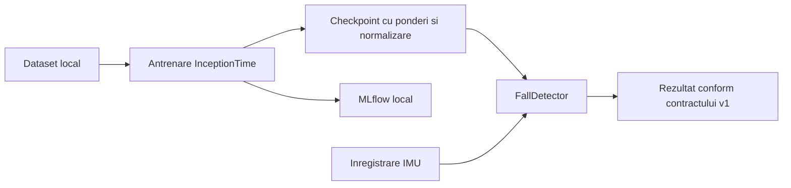

# Arhitectura proiectului

Proiectul este un monorepo: un singur repository Git, cu componente separate.
Aceasta este o alegere simpla pentru faza curenta, cand firmware-ul, aplicatia
si modelul trebuie sa evolueze impreuna, dar au dependente si cicluri de
executie diferite.

| Director | Responsabilitate | Stare actuala |
|---|---|---|
| `firmware/watch` | Colectare senzori, conectivitate, energie, interactiune pe ceas | Structura pregatita |
| `apps/companion` | Interfata utilizatorului si interactiunea cu ceasul | Structura pregatita |
| `ml` | Pregatire date, antrenare, evaluare, inferenta | Implementat in PyTorch |
| `shared/contracts` | Format comun pentru schimbul de rezultate | Contract de clasificare v1 |
| `docs` | Decizii, cercetare si limitele evaluarii | Documentat |

## Delimitarea antrenarii de folosirea modelului

Antrenarea citeste datasetul si produce checkpoint-uri. MLflow pastreaza
configuratia si rezultatele experimentelor. Aceste instrumente apartin
componentei ML si nu sunt necesare interfetei utilizatorului.

Folosirea modelului incarca un checkpoint cu `FallDetector`, preproceseaza
semnalul conform conventiilor documentate si returneaza un rezultat versionat.
Modulul de inferenta nu importa MLflow sau scikit-learn.

Diagrama descrie fluxul ML existent. Transportul de la ceas, locul executiei
inferentei, notificarea si confirmarea alertei vor fi stabilite dupa alegerea
hardware-ului si platformei aplicatiei. Nu exista inca un serviciu backend sau
o aplicatie implementata. Daca apare nevoia unui backend, poate fi adaugat
ulterior in `services/`, fara mutarea codului ML.

## Stocare si versionare

- `ml/` contine cod reproductibil si configuratii, nu datasetul.
- `data/` contine intrari locale, excluse din Git.
- `artifacts/` contine rezultate binare si stocarea MLflow, excluse din Git.
- `reports/` contine rezultate mici si explicabile, versionabile.
- `archive/` pastreaza experimentele depasite numai pe calculator.

Importul modelului nu trimite automat notificari. Un rezultat de clasificare
si o alerta confirmata de sistem sunt concepte distincte; aplicatia va defini
explicit tranzitia dintre ele.
